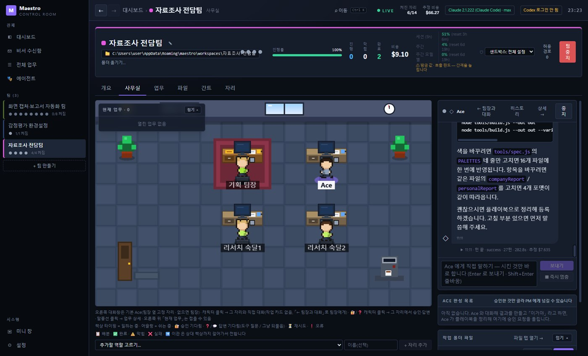
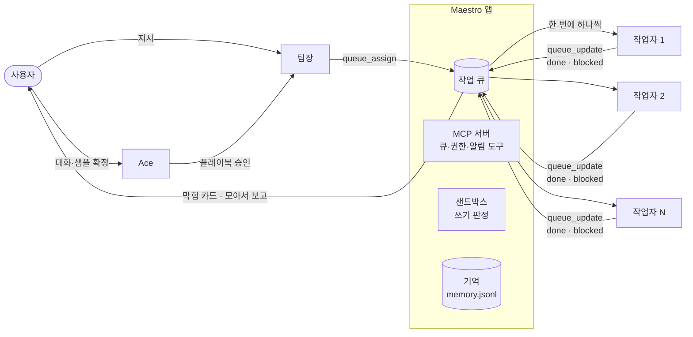
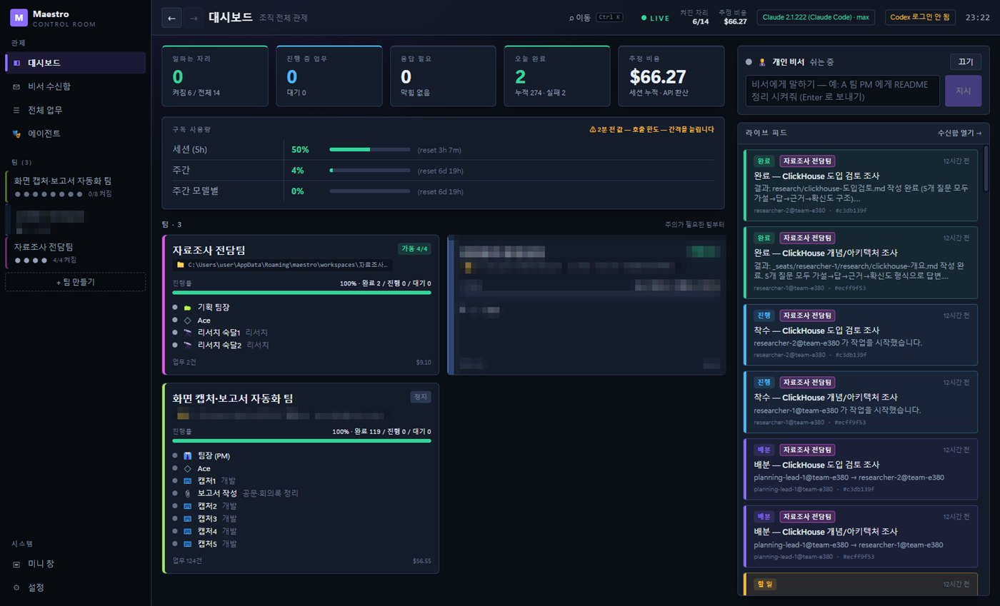
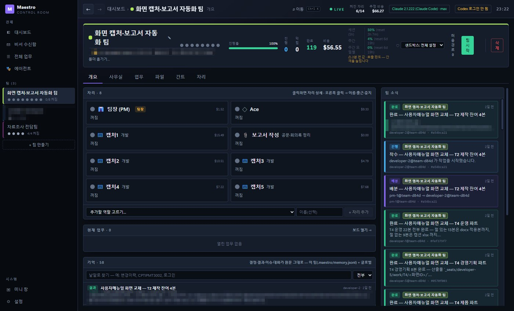
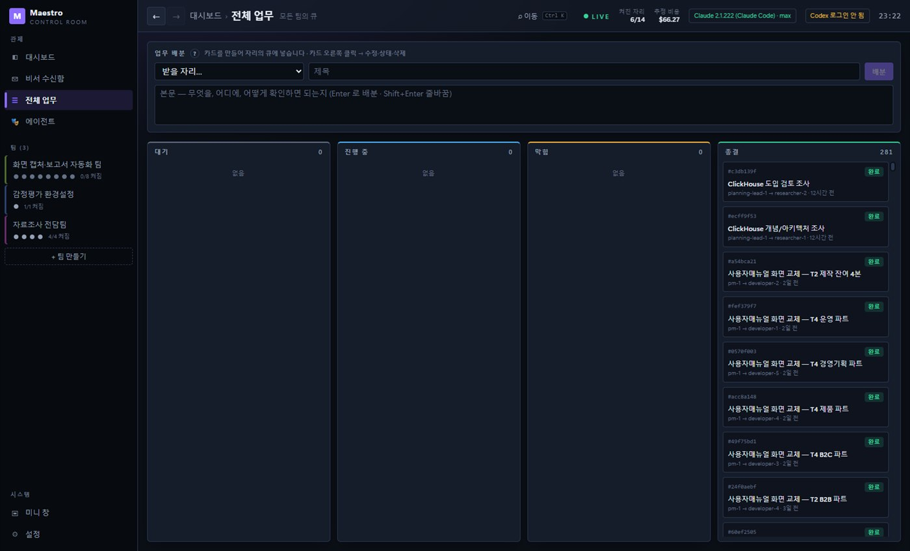
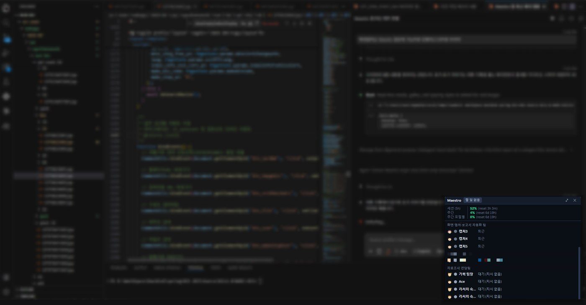

Maestro: AI 에이전트 팀 오케스트레이터
=====================================

### 설치된 Claude Code 를 역할마다 하나씩 띄워, 팀으로 일하게 하는 Windows 데스크톱 앱.

**지시는 한 번, 진행은 눈으로. 막히면 카드 하나로 풉니다.**

**[포트폴리오 사이트](https://woolia.github.io/maestro-portfolio/)** · **[실제 사례](https://woolia.github.io/maestro-portfolio/#evidence)** · **[설계 결정](https://woolia.github.io/maestro-portfolio/#decisions)** · **[발전 과정](https://woolia.github.io/maestro-portfolio/#changelog)**

[작동 방식](#작동-방식) · [할 수 있는 것](#할-수-있는-것) · [사례](#사례) · [설계 결정](#설계-결정) · [FAQ](#faq) · [이 저장소](#이-저장소)

> [!NOTE]
> 이 저장소는 Maestro 를 소개하는 **포트폴리오 사이트**입니다. 앱 소스는 공개하지 않습니다.
> 화면 캡처의 회사 이름·내부 경로는 모자이크했습니다.

AI 코딩 도구 하나에 큰 일을 맡기면 세 가지가 반복됩니다. 지시·코드·검증이 한 대화에 섞여 맥락이 무너지고, 결정이 채팅에만 남아 다음 세션에서 처음부터 다시 파악하고, 지금 일하는지·내 답을 기다리는지·멈췄는지 보이지 않습니다.

Maestro 는 이걸 **역할 분리(자리) + 구조화 메시지(작업 큐) + 파일 격리(샌드박스) + 눈에 보이는 상태**로 풉니다. 19일 동안 47번 릴리스하며 매일 실제 업무를 맡겼고, 에이전트들이 처리한 작업은 281건입니다.

> "지시하고 시키는 걸 웹에서 하고 싶은데… 각각 어떤 AI, 에이전트가 일하고 있고 쉬는지 그런 건 가능한가?"
> — 2026-10-06, 처음 구상하며 던진 질문

## 작동 방식

- 자리마다 **설치된 Claude Code**(구독 로그인)를 `claude -p --input-format stream-json` 상주 프로세스로 띄웁니다. Codex 는 `codex app-server` 로 같은 자리에 꽂힙니다.
- 앱이 띄운 **MCP 서버**가 큐·권한 요청·알림 도구를 줍니다. 에이전트끼리는 채팅하지 않고 작업 카드로만 일을 주고받습니다.
- 모든 쓰기는 앱이 판정합니다. 자리는 자기 폴더에만 쓰고, 원본 자료와 남의 산출물은 읽기·복사만 됩니다.

## 할 수 있는 것

| 영역 | 하는 일 | 어디서 |
|---|---|---|
| **팀 꾸리기** | 요구사항 문서를 비서에게 끌어다 놓으면 역할·인원을 고른 팀 구성안. 버튼 하나로 생성·시작 | 비서 수신함 |
| **자리(역할)** | 내장 역할 21종 · 전문 지식 프레임 29종. 역할마다 모델·도구·턴 상한·세션 수명(작업마다 리셋 / 유지) | 에이전트 |
| **작업 큐** | 배분 · 착수 · 완료 · 막힘 · 회수. 작업자는 한 번에 하나, 막힘이 풀린 일이 먼저 | 전체 업무 · 팀 업무 |
| **막힘 해결** | 7종 원인 + 해결안 A·B·C. 사람은 "누가 / 어떻게" 만 고르면 같은 작업이 다시 전달. 같은 원인은 묶어서 한 번에 | 막힘 카드 · 토스트 |
| **Ace · 플레이북** | 사람과 샘플 한 건을 확정 → 플레이북 → 팀장이 대상만 나눠 배분. 못 끝낸 대상은 `ISSUES.md` | 사무실 · Ace 카드 |
| **기억** | 결과·이슈·결정·압축 전 대화를 원문으로 저장, 한글 2글자 색인. 판정 모델(Jev)이 대화 분류 | 팀 개요 「기억」 |
| **관제** | 대시보드 · 타이쿤 사무실 · 미니 창(항상 위) · 구독 사용량(세션 5h·주간·모델별) | 대시보드 · 사무실 |
| **즉시 멈춤** | 지금 턴을 바로 끊음(`interrupt`). 팀장 카드에서 맡긴 업무 중지 · 다시 진행 | 대화창 · 자리 카드 |
| **운영** | 사용 한도·턴 한도 자동 재개, 재시작 후 이어쓰기, 자동 압축, 자체 업데이트·백업, 기억 폴더·작업 폴더 옮기기 | 설정 |
| **코드 편집기** | 사무실 탭 세 칸(사무실·대화 \| 작업 폴더 \| 편집기), CodeMirror 탭 편집·Ctrl+S, 자동완성·스니펫, PDF·이미지·docx·xlsx 미리보기, 트리에서 새 파일·폴더·Java 클래스(package 자동)·복사·이름 바꾸기·삭제 | 사무실 · 파일 |
| **언어 지원** | VS Code 확장처럼 언어별 설치 — TypeScript·Pyright·Eclipse JDT LS. 멤버 자동완성, F12 정의 이동, F2 이름 바꾸기, 타입·컴파일 오류 + 컨벤션(ESLint·Checkstyle·Ruff). 팀별 언어 버전(Python·ECMAScript·Java) | 설정 「확장」 · 팀 「언어 버전」 |
| **Ctrl+K 인라인 AI** | Cursor 처럼 한 줄 지시 → 코드만 회색 미리보기 → Enter 적용 · Esc 버림. 줄을 고르면 그 줄만 | 편집기 |

  
  

  
  

## 사례

### 사내 매뉴얼 화면 교체 자동화

팀장 · Ace · 캡처 담당 5 · 보고서 담당, 8개 자리로 작업 124건 중 119건을 끝냈습니다. 처음엔 대상 128개 중 39개가 **조용히 빠졌고**, 그 일로 "샘플 → 플레이북 → 대상 목록 → 미처리 기록" 흐름과 Ace 를 만들었습니다. 테스트 계정이 만료돼 다섯 자리가 같은 이유로 막혔을 때는 원인 이름으로 묶여 한 번에 풀렸습니다.

### 자료조사 전담팀

비서에게 "자료조사를 전문으로 하는 팀 구성해줘" 한 문장 → 기획 팀장 · Ace · 리서처 2명 팀이 제안·생성됐고, 기술 도입 검토 보고서 2건을 가설 → 답 → 근거 → 확신도 형식으로 냈습니다.

### 첫 팀 — 웹 테트리스

7명 팀의 첫 실전에서 개발 자리의 브라우저 검증 스크립트가 같은 디버그 포트로 Maestro 창을 탈취했습니다. 창 이동 가드와 자동 복구, 샌드박스의 원격 디버그 포트 차단이 여기서 나왔습니다.

## 설계 결정

| 결정 | 왜 |
|---|---|
| SDK 대신 설치된 Claude Code 를 자식 프로세스로 | 구독 로그인을 그대로 쓰기 위해(서드파티 앱에 구독 로그인 연결 불가). 스파이크: 자리 3개 동시 기동 13.5초, 자리당 약 370MB |
| 채팅 대신 카드, 막힘은 "사람 차례" | 실측 큐 103건 중 11건이 막혔고 6건은 영영 막힌 채였음 |
| 판단은 사람과 Ace, 팀장은 배분만 | 팀장이 스스로 설계·정정 작업을 덧붙임(하루 54건 중 11건) |
| 토큰은 실측하고 구조로 줄인다 | 호출당 고정 비용 42K(도구 정의 22K · 글로벌 설정 9K) → 도구 화이트리스트(22K → 약 4K), 세션 리셋, 자동 압축, 작업자 MCP 도구 8 → 3 |

자세한 이슈 8건과 해결은 [사이트의 설계 결정](https://woolia.github.io/maestro-portfolio/#decisions)에 있습니다.

## FAQ

**LangChain·AutoGen 을 쓰면 되지 않나요?**
프로젝트마다 오케스트레이션 코드를 새로 짜야 합니다. Maestro 는 역할 정의서(Markdown)와 플레이북만 바꿔 다른 일에 씁니다.

**API 비용은 얼마나 드나요?**
구독(Max) 로그인으로 돌립니다. 화면의 금액은 Claude Code 가 계산한 API 환산 추정치이며 실제 청구액이 아닙니다. 대신 구독 사용량(세션·주간·모델별 %)을 실시간으로 보여 줍니다.

**에이전트가 파일을 망가뜨리지 않나요?**
모든 쓰기 도구 호출을 앱이 판정합니다. 자기 폴더 밖 수정·삭제·이동·덮어쓰기와 시스템·파괴적 명령은 거부합니다.

**에이전트가 없는 사실을 지어내면요?**
공통 규범으로 자료에 없는 사실은 `[확인 필요: …]` 로 비워 두게 하고, 결과에는 "됐다" 대신 "무엇을 실행해 무엇을 봤다" 를 쓰게 합니다.

## 이 저장소

| 파일 | 내용 |
|---|---|
| `index.html` | 포트폴리오 한 페이지(Hero · Problem · Maestro · Evidence · Decisions · Changelog · Gallery) |
| `style.css` | 디자인 토큰과 컴포넌트 스타일(다크) |
| `main.js` | 헤더·햄버거 메뉴·현재 섹션 표시 |
| `assets/` | Maestro 화면 캡처(모자이크·흐림 처리본) |

빌드 도구 없이 정적 파일만 씁니다. 로컬에서 `index.html` 을 열면 바로 보이고, GitHub Pages 가 `main` 브랜치를 그대로 배포합니다.

## 참고

- 숫자(릴리스 47회 · 작업 281건 · 테스트 257개 · 코드 약 2.2만 줄)는 2026-10-24 기준 앱의 변경 기록·큐 데이터·테스트 결과에서 셌습니다.
- 사이트의 "관전형 추첨 게임"·"자격증 문제풀기 웹앱" 사례는 다른 PC 에서 운영한 팀의 기록입니다.
